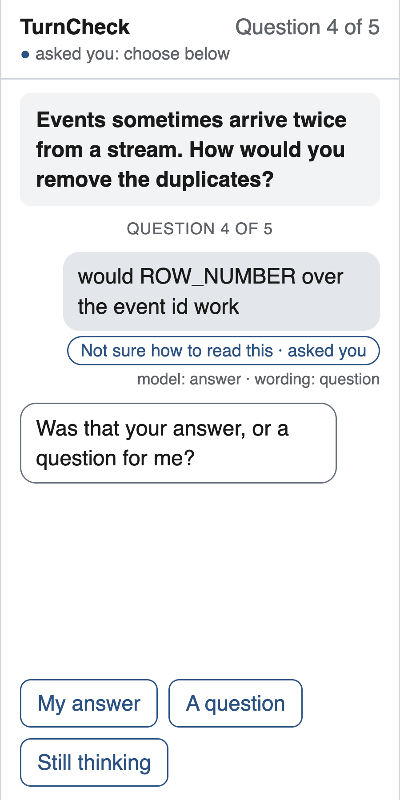

# TurnCheck

A prototype AI interviewer that reads each candidate turn before it counts: is it an answer, a question, or still thinking?
When it is not sure it asks. It replies to questions only from a prepared sheet, and it never scores.

Built for Intelligent Interactive Systems, Assignment 2 (University of Birmingham). The submitted version is the tag `a2-submission`.
*README prose: about 1,300 words. Code, commands and commit ids are not counted.*

<p>
  
  
  
</p>

## Project status

**Made, and working on my laptop**
- The interview screen, one page in the browser: the question, a label under every turn saying how it was read, one-tap correction, a state line, and the record at the end.
- The controller (`turncheck/controller.py`): a fixed workflow that acts, asks or waits. Every edge has a test.
- Two readings of each turn: a local model's label and a check of the wording. When they disagree, TurnCheck asks instead of recording.
- Clarifications from a prepared sheet. The model only names a sheet entry; every word the candidate reads is in `interview/data-engineer.json`.
- A trace of every model call, and a replay harness that runs scripted turns, or a whole scripted interview, through the same controller.

**Simulated**
- Speech. Turns are typed, and question marks are removed because a transcript may not have them.

**Not finished**
- No test on turns written by a person. The AI wrote every test turn, so `results/` shows that the system runs and where it breaks, not how well it reads real candidates. `replay/heldout.tsv` is empty and waits for a person's turns.
- Two failures the stress turns found are not fixed: a question phrased as a statement can be recorded as an answer, and an answer with a check attached loses the check.
- A reading can only be corrected until the next turn.
- One role, five questions, one interview at a time.

**Planned**
- Speech recognition and spoken replies.
- A view for the human assessor.
- A comparison with a fixed script and with an "ask" button (Phase 3).

## Technology stack

| Part | What it does | Status |
|---|---|---|
| Python, standard library only (run on 3.13) | server, controller, replay, tests | in use |
| [Ollama](https://ollama.com) 0.40.13 | runs the model on the laptop: no key, no paid service, nothing sent out | in use |
| `qwen2.5:7b` (4.7 GB) | labels a turn, and names a sheet entry for a question, each as fixed-schema JSON | in use |
| Wording check (regular expressions) | the second reading: is the turn phrased as a question? | in use |
| HTML, CSS and JavaScript, no framework | the screen; it only draws what the controller sends | in use |
| draw.io file format | the two diagrams in `docs/`, written and checked for crossing lines by `docs/make_diagrams.py` | in use |
| Speech-to-text | spoken turns | planned, tool undecided |

## Running or inspecting the work

**Without running anything**
- `docs/screenshots/`: the screens.
- `results/traces/storyboard-interview.json`: one whole interview, with every screen, every model call and every edge taken.
- `results/*.txt`: one line per replayed turn. `2026-11-15-stress-turns.txt` is the run that shows where it breaks.
- `docs/architecture.svg` and `docs/turn-graph.svg`: the diagrams (the `.drawio` files open in draw.io).

**Running it**

```bash
ollama pull qwen2.5:7b        # once; about 4.7 GB
python3 app.py                # then open http://localhost:8000
```

Without Ollama the screen still runs: TurnCheck then asks how to read every turn instead of guessing.

**Stepping through the saved interview, with no model**

```bash
python3 app.py                # then open http://localhost:8000/?trace=storyboard-interview&step=3
```

Change `step` from 0 to 14.

**Tests and replay**

```bash
python3 -m unittest discover tests                        # no model needed
python3 replay/replay.py turns replay/dev-turns.tsv       # needs Ollama
python3 replay/replay.py interview replay/storyboard-interview.json
python3 docs/make_diagrams.py                             # rewrites both diagrams, checks no lines cross
```

## Development record

Commits: <https://github.com/ShreehariA/turncheck/commits/main>. I made the first nine myself, eight of them together on 15 Nov once the build worked. From the tenth, the AI committed at my request; those carry its co-author line. The steps of 23 Oct and 14 Nov came before their commits, so their evidence is the file each row names, not the commit time.

| When | Change | Why | What was checked | Commit |
|---|---|---|---|---|
| 23 Oct | Spike: a local model labels 13 turns | can a free local model do the one inference the design needs? | 11 of 11 clear turns right (`spike/results-2026-10-23.txt`) | [a606088](https://github.com/ShreehariA/turncheck/commit/a6060888ffe15e9e1d4f78685c9875a0cc8abc59) |
| 23 Oct | A second reading decides when to ask | the model gave its label 0.97 or more even on turns written to be ambiguous | 13 of 13 handled, on turns the rule's own author wrote: a sanity check | [a606088](https://github.com/ShreehariA/turncheck/commit/a6060888ffe15e9e1d4f78685c9875a0cc8abc59) |
| 14 Nov | Controller as a fixed workflow; the model returns only a label or an entry id | a wrong reply can then, at worst, pick the wrong prepared reply | a test per edge (`tests/test_controller.py`) | [a777892](https://github.com/ShreehariA/turncheck/commit/a7778922bedc8aa0dd101b510f9debf4bc210e18) |
| 14 Nov | Screen: how each turn was read, a one-tap fix, a state line | the candidate should see what counted and correct it | `docs/screenshots/`: real screens from the saved interview | [5483d42](https://github.com/ShreehariA/turncheck/commit/5483d4270000c75f2ac9ae3bfe0192a0d968f8a3) |
| 14 Nov | "Still thinking" became correctable; thinking aloud that disagrees with the wording now asks | first replay: 4 of 19 questions were read as thinking aloud and met silence | `results/2026-11-14-dev-turns.txt` against `-run2.txt` | [a777892](https://github.com/ShreehariA/turncheck/commit/a7778922bedc8aa0dd101b510f9debf4bc210e18), [ccb888d](https://github.com/ShreehariA/turncheck/commit/ccb888d784848eabf04b7968ea3fd34e1c828c2b) |
| 14 Nov | One sheet entry reworded; prompt left alone | a hint leaked because the entry's description named the answer; two prompt changes made it worse | `results/2026-11-14-entry-picker-notes.txt`; 30 of 31 expected entries (`-run3.txt`) | [d3e4f8d](https://github.com/ShreehariA/turncheck/commit/d3e4f8d859e09e3a1c844f194634c32d9d233a97), [ccb888d](https://github.com/ShreehariA/turncheck/commit/ccb888d784848eabf04b7968ea3fd34e1c828c2b) |
| 14 Nov | Saved interviews must replay to the same screens | so screenshots cannot drift from the code | `tests/test_traces.py` | [ccb888d](https://github.com/ShreehariA/turncheck/commit/ccb888d784848eabf04b7968ea3fd34e1c828c2b) |
| 15 Nov | Three sheet replies reworded | one misled, one asked for more than its question, one left a single thing to check | replies are never sent to the model; dev turns re-run, same 42 outcomes (`results/2026-11-15-dev-turns.txt`) | [d1cd4d5](https://github.com/ShreehariA/turncheck/commit/d1cd4d5f7af44b74e6a9ec01a38a2936aea376bd) |
| 15 Nov | Diagram script added; one label fixed | in draw.io's viewer a label wrapped onto its arrow | `docs/in-drawio/`: both files as draw.io draws them | [dca3a21](https://github.com/ShreehariA/turncheck/commit/dca3a21f95a20625b9e2f29e872c0176b934d975) |
| 15 Nov | Rule frozen (tag `frozen-v1`), then 30 stress turns written to break it, run once | every earlier turn was written alongside the rule | `results/2026-11-15-stress-turns.txt`; nothing changed afterwards | [a889623](https://github.com/ShreehariA/turncheck/commit/a889623670c4ed918f7c9b2aee018ae4cd6c6888), [d102d5f](https://github.com/ShreehariA/turncheck/commit/d102d5f5c49e906c57b2a3122e72d53f466da158) |
| 15 Nov | A miss from that run added to the saved interview | storyboards should show the worst failure and its repair | `tests/test_traces.py`; screenshots `3a` to `3c` | [ecf9274](https://github.com/ShreehariA/turncheck/commit/ecf9274c43f2e8417395eedfa186e1d7cd644337) |

**Dev turns** (42, written by the AI while building): 31 handled as meant, 8 asked about, 3 questions read as thinking aloud, none recorded as an answer.

**Stress turns** (30, written by the AI to break the frozen rule, run once): 2 handled as meant, 17 asked about (one extra tap each). Of 10 questions phrased as statements, 2 were recorded as answers and 2 were read as thinking aloud; after one tap, all 10 got the expected sheet entry. All 6 turns that are an answer and a check at once ("…does that make sense") were recorded as plain answers, so the check got no reply.

Neither is evidence of accuracy: the first set was written alongside the rule, the second was chosen to be hard.

## AI assistance

- **Tool:** Claude Code in the terminal. Claude Fable 5.2 did the build (14 November) and the finishing work (15 November); Claude Opus 5.5 did the October draft and, on 15 November, a check of the public repository and the first commit links.
- **What the AI did:** almost all of the building and writing: the spike, controller, screen, replay harness and tests; every test turn; the questions and sheets; the diagrams and screenshots; this README; the text and figures of the project report; and the commits from the tenth on.
- **What I set:** the problem, from my own AI interview; no paid service and no key; a local model; that the AI never scores; diagrams in draw.io format, black and white, no crossing lines.
- **What it proposed and I accepted:** the two readings and "ask when they disagree"; the fixed sheet; standard library only.
- **What I changed:** the diagrams, which I asked to be redone in draw.io format in my usual style, and who commits. The code, questions and sheets are as the AI wrote them.
- **How it was checked:** every check recorded here was run by the AI at my request: a test per edge, the replays in `results/`, both diagrams opened in draw.io's viewer, a fresh clone run from this README, and the report's lecture and guideline claims against the slides and papers. No test turn was written by a person.
- The agent's standing rules are in `AGENTS.md`.

## Additional files

- `docs/design-notes.md`: contracts for each action, the pattern and the case against it, the numbers, sensors and privacy.
- `spike/`: the October spike, its two runs, and the README as it was then.
- The project report is submitted on Canvas. There is no ZIP.
