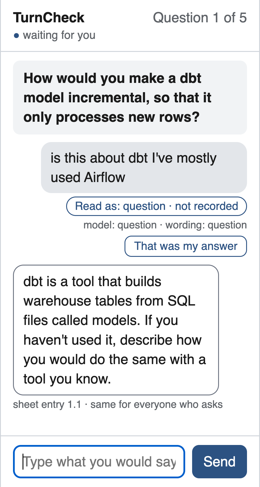
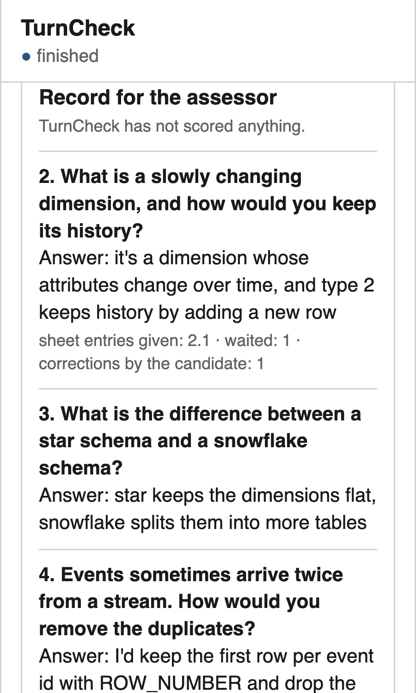

# TurnCheck

In an AI interview for a data engineering role, I was asked a question about dbt, a tool I had barely used. Thinking aloud, I asked whether it was about dbt. The system took my question as my answer and moved on.

TurnCheck is a prototype interviewer that works out what each turn was before it counts it: an answer, a question, or the candidate still thinking. When it isn't sure, it asks. It replies to questions only from a prepared sheet, and it never scores; a person reads the record.

Coursework for Intelligent Interactive Systems, University of Birmingham. The version submitted for Assignment 2 is the tag [`a2-submission`](https://github.com/ShreehariA/turncheck/tree/a2-submission). Since then TurnCheck's code and results are unchanged; the README, the design notes, one diagram label and some file headers were rewritten in plainer language, and a few files removed.

*README prose: about 1,430 words, not counting code, commands and commit ids.*

<p>
  
  
  
</p>

## How it works

A *turn* is one thing the candidate says. TurnCheck reads each turn twice:

1. a local AI model (Qwen2.5 7B, run by Ollama) labels it as an answer, a question, or unfinished (still thinking);
2. a few text patterns (regular expressions) check whether it is worded as a question.

Then fixed code, not the model, decides what to do:

- both readings say answer: the answer is recorded and the next question comes;
- both say question: TurnCheck replies from the *sheet*, a list of replies prepared for each question, or says it can't help if none fits;
- the model says unfinished and the turn isn't worded as a question: TurnCheck waits, and after two waits in a row asks whether to keep thinking, hear the question again or move on;
- the readings disagree, or the model fails: TurnCheck asks the candidate which it was.

The model only ever picks a label or the id of a prepared reply, so it never writes anything the candidate reads. Under each turn the screen shows how it was read, and one tap corrects it. All the paths are drawn in [`docs/turn-graph.svg`](docs/turn-graph.svg), and each one has a test.

## Project status

- **Working** on my laptop: everything above, the record at the end, and a replay tool that runs scripted turns, or a whole scripted interview, through the same code.
- **Simulated:** speech. Turns are typed, and question marks are removed, because a speech transcript may not have them.
- **Not done:** a test on turns written by someone who hasn't seen TurnCheck's prompts and rules; every test turn so far was written by the AI. Two failures found by the stress turns (turns written to break it) are not fixed: a question worded as a statement can be recorded as an answer, and an answer with a check on the end ("…, does that make sense") loses the check. A reading can be corrected only until the next turn. One role, five questions, one interview at a time.
- **Planned:** speech in and out, a view for the assessor, and a comparison with a fixed script and with an "ask" button (Phase 3).

## Technology stack

- Python 3 (run on 3.13), standard library only, so there is nothing to `pip install`.
- [Ollama](https://ollama.com) 0.40.13 running the `qwen2.5:7b` model (4.7 GB) on the laptop: no API key, no paid service, nothing sent out.
- Plain HTML, CSS and JavaScript for the page.
- draw.io for the two diagrams.
- Speech-to-text: planned, tool not chosen.

## Running or inspecting it

You need Python 3 and, for live interviews, [Ollama](https://ollama.com) installed and running.

```bash
git clone https://github.com/ShreehariA/turncheck.git
cd turncheck
ollama pull qwen2.5:7b    # once; downloads about 4.7 GB
python3 app.py            # then open http://localhost:8000
```

The terminal should print `Model qwen2.5:7b is ready.` Without Ollama the page still works, but TurnCheck asks you how to read every turn. On Windows, type `python` instead of `python3`; TurnCheck has only been run on macOS.

To step through the saved interview with no model, keep `app.py` running and open <http://localhost:8000/?trace=storyboard-interview&step=3>, changing `step` from 0 to 14.

```bash
python3 -m unittest discover tests                    # all the tests; no model needed
python3 replay/replay.py turns replay/dev-turns.tsv   # needs Ollama; writes new files to results/
```

Without running anything: the screens are in `docs/screenshots/`, every replayed turn is one line in `results/*.txt`, and `results/traces/storyboard-interview.json` is a whole interview with every model call.

## What's where

| Path | What it is |
|---|---|
| `app.py` | the local web server; start here |
| `turncheck/controller.py` | what TurnCheck does with each turn |
| `turncheck/readings.py` | the two readings: the model call and the wording check |
| `interview/data-engineer.json` | the five questions, their sheets, and every line TurnCheck says |
| `static/` | the web page; it only draws what the server sends |
| `tests/` | a test for every path in the turn graph, and a check that the saved interview still replays the same |
| `replay/` | the replay tool, and the test turns and scripted interview it runs |
| `results/` | the output of every replay run, and the saved interview in `traces/` |
| `docs/` | the diagrams, the screenshots and the design notes |
| `spike/` | the first experiment, from October |

## Changing it

- **Questions and replies** are in `interview/data-engineer.json`. After editing, run the tests; they catch a missing phrase, button or reply, and repeated ids.
- **Test turns** go in `replay/dev-turns.tsv`, one per line: `question number | answer, question, thinking or unsure | the turn`. Then run the replay.
- **Keep old results.** The prompts, the wording check, the rules and the sheets were frozen at the tag `frozen-v1` before the stress run. If you change any of them, re-run the replays and keep the old results beside the new ones.

## Development record

[All commits](https://github.com/ShreehariA/turncheck/commits/main). I made the first nine; Claude Code made the next seven at my request, and they carry its co-author line. Work from October and 14 November was committed on 15 November, so for those steps the evidence is the file named.

- **23 Oct** ([a606088](https://github.com/ShreehariA/turncheck/commit/a6060888ffe15e9e1d4f78685c9875a0cc8abc59)): a spike, meaning a quick first experiment. The model labelled 11 of 11 clear turns right but was 0.97 or more sure even on ambiguous ones, so a second reading was added, and TurnCheck asks when the two disagree (`spike/results-2026-10-23.txt`).
- **14 Nov** ([a777892](https://github.com/ShreehariA/turncheck/commit/a7778922bedc8aa0dd101b510f9debf4bc210e18), [5483d42](https://github.com/ShreehariA/turncheck/commit/5483d4270000c75f2ac9ae3bfe0192a0d968f8a3)): the controller as fixed code with a test for every path, and the screen.
- **14 Nov** ([916b2ba](https://github.com/ShreehariA/turncheck/commit/916b2ba9504b42aad5b37f9b839454d03c60cc9b)): both diagrams in draw.io, in my usual style (black and white, no crossing lines), at my request.
- **14 Nov** ([ccb888d](https://github.com/ShreehariA/turncheck/commit/ccb888d784848eabf04b7968ea3fd34e1c828c2b)): the first replay left 4 of 19 questions in silence as thinking aloud, so "still thinking" became correctable, and thinking aloud worded as a question now asks (`results/2026-11-14-dev-turns.txt`, then `-run2.txt`).
- **14 Nov** ([d3e4f8d](https://github.com/ShreehariA/turncheck/commit/d3e4f8d859e09e3a1c844f194634c32d9d233a97)): a hint leaked through a sheet entry that described the answer. Two prompt changes made it worse; rewording the entry fixed it (`results/2026-11-14-entry-picker-notes.txt`).
- **15 Nov** ([d1cd4d5](https://github.com/ShreehariA/turncheck/commit/d1cd4d5f7af44b74e6a9ec01a38a2936aea376bd)): three sheet replies reworded; the dev turns gave the same 42 outcomes.
- **15 Nov** ([a889623](https://github.com/ShreehariA/turncheck/commit/a889623670c4ed918f7c9b2aee018ae4cd6c6888), [d102d5f](https://github.com/ShreehariA/turncheck/commit/d102d5f5c49e906c57b2a3122e72d53f466da158)): the prompts, wording check, rules and sheets frozen, meaning no more changes (tag `frozen-v1`), then 30 turns written to break them, run once and left as they came out.
- **15 Nov** ([ecf9274](https://github.com/ShreehariA/turncheck/commit/ecf9274c43f2e8417395eedfa186e1d7cd644337)): a real miss from that run, and its one-tap fix, added to the saved interview.

**Results.** Dev turns (42, written while building): 31 handled as meant, 8 asked about, 3 questions read as thinking aloud, none recorded as an answer. Stress turns (30): 2 handled as meant and 17 asked about; 2 of 10 questions worded as statements were recorded as answers, and all 6 answers with a check on the end lost the check. The AI wrote both sets, so neither measures accuracy.

## AI assistance

I used Claude Code in the terminal. Claude Fable 5.2 did the build and finishing work on 14 and 15 November; Claude Opus 5.5 did the October draft, a check of the public repository on 15 November, and the 25 November cleanup of the repository and the report.

- **What I did:** chose the problem, from the interview above; set the limits (a local model, no paid service or key, and an AI that never scores); approved the design before it was built, accepting its proposals of two readings, "ask when they disagree", a fixed sheet and the standard library only; asked for the diagrams in draw.io in my black-and-white style; on 25 November, judged this README too long and too AI-sounding, and asked for it and the report to be reviewed and rewritten in plain language; and made the first nine commits and those from 25 November on.
- **What the AI did:** almost all of the building and writing: the spike, controller, screen, replay tool and tests; every test turn; the interview questions and sheets; the diagrams and screenshots; this README; the report's text and figures; and commits 10 to 16.
- **Reused:** Ollama and the Qwen2.5 7B model, used as they are. Nothing else is taken from elsewhere.
- **How it was checked:** the AI ran every check recorded here, at my request: a test for every path, the replays in `results/`, a run from a fresh clone, and the report's claims against the lecture slides and papers. No test turn was written by a person.

`AGENTS.md` holds the rules given to the AI coding assistant.

## Additional files

- `docs/design-notes.md`: what the lectures ask of a Phase 2 project, answered for TurnCheck: contracts, the pattern and the case against it, the numbers behind the one inference, sensors and privacy.
- `spike/`: the October spike, its runs, and the README as it was then.
- The report is submitted on Canvas; there is no ZIP.
